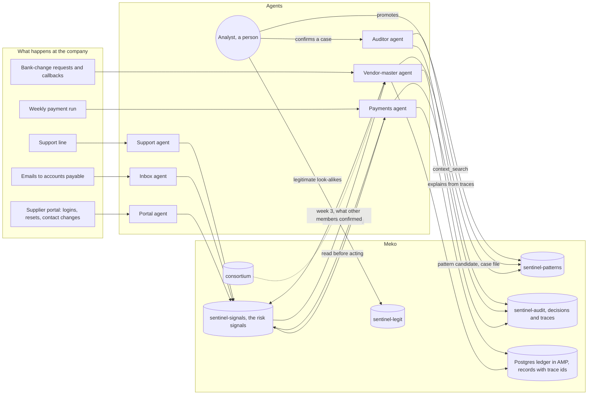
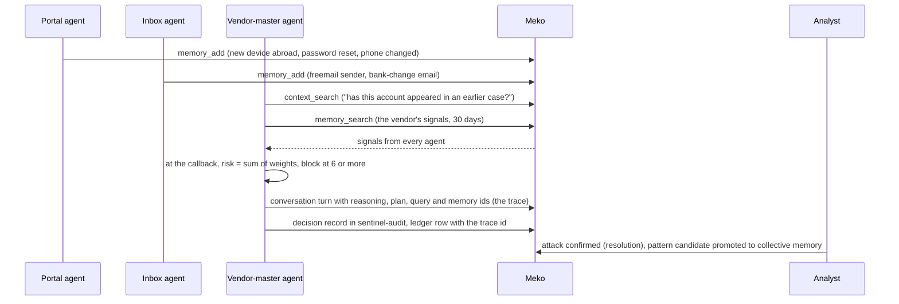

# Architecture

Payee Sentinel is a team of accounts-payable agents that share what they see through Meko, so that a vendor-account
takeover is stopped before the money leaves. The money decisions are rules in code, fixed before any evaluation
(`payee_sentinel/agents.py`). Meko holds everything the agents learn, why each decision was taken, and the company's
own records. Feature by feature, with the code that uses each: `docs/MEKO_USAGE.md`.

## The pieces

| Piece | What it does | Code |
|---|---|---|
| **Channel agents** | The portal, inbox, support and vendor-master agents each watch one channel and write what looks risky as a weighted signal (`memory_add` in `sentinel-signals`). | `agents.py` |
| **Decisions** | Before an action that matters, an agent searches Meko for the vendor's signals of the last 30 days and adds up their weights, each signal type once. The vendor-master agent blocks a confirmed bank change at risk 6 or more, and rejects one the vendor denies when called back. The payments agent holds a payment at risk 7 or more, and asks for a call to the number on file 60 days earlier at risk 4 or more after a recent bank change. | `agents.py` (`BLOCK_BANK_CHANGE_AT`, `HOLD_AT`, `STEP_UP_AT`) |
| **Approved patterns** | When the analyst confirms an attack, the auditor writes the signal types the vendor showed as a pattern candidate. A person promotes it (`POST /promote-memories`), and it becomes collective memory. A vendor whose signals then cover at least 60 % of an approved pattern, with 3 or more types in common, is frozen before anyone asks to change its bank details. Learning v2 also remembers the legitimate look-alikes the analyst confirmed (`sentinel-legit`) and does not freeze for them. | `agents.py` (`Agent._check_patterns`, `Memory.learned_match`) |
| **Decision traces** | Every decision, allow included, is a conversation turn in Meko with its reasoning, its plan and its metadata: the query, the datapack and the ids of the memories behind it. The same decision goes into `sentinel-audit` as a record the auditor can search. | `story.py` (`Lane._decision`) |
| **The analyst** | A person. Confirms or clears what an agent stopped by calling the vendor on the number on file 60 days earlier, which is an *as of* query on the ledger. Closes the case in memory and decides what becomes collective memory. | `story.py` (`Lane.review`), `Story.promote` |
| **The auditor** | Explains a decision from its trace, quoting the policy behind the rule from the knowledge base. Saves the case report as an artifact. Runs Meko's self-learning loop: finds the vendor-master agent's weak question in Meko's search log, adds the confirmed case file to the knowledge base and asks Meko to replay the question. | `story.py` (`Story.explain`, `Story.self_learning`) |
| **The ledger** | The system of record, in a Postgres cluster inside `sentinel-audit` (Meko AMP): vendors, vendor_history, bank_changes and payments. Every record a decision writes carries that decision's trace id. Where the database cannot be reached, the same schema runs on SQLite. | `ledger.py` |
| **The consortium** (week 3, round 5) | A `consortium` datapack shared by member companies. It holds the account, phone and device of every attack an analyst confirmed, each with the trace of the decision behind it. Approved patterns go into each member's collective memory, and confirmed case files into its knowledge base. When a listed value comes back, the agent that sees it adds `consortium.known_infrastructure` (+6). A member can take a case back with a revocation record; nothing is deleted. In the demo, both companies are simulated in one place. | `story.py` (`Story.share`, `Lane._check_known`), `evaluate.py` (`run_consortium`) |
| **Claude** (optional) | With `ANTHROPIC_API_KEY` set, Claude Opus 5.5 reads each email for the Meko lane's inbox agent, quoting the words behind every red flag, and explains the auditor's decision in plain words. Quotes not found in the email, and sentences citing a memory or a number the trace does not hold, are dropped in code. Claude's flags carry no weight, so the decisions stay those of the measured rules. Token use goes to Meko (`track_token_usage`). Without a key nothing changes. | `reader.py` |

## One decision, end to end

The next time a vendor shows the same steps, the approved pattern freezes it as soon as the match is complete. In the
demo, in week 2 that is at the email that asks for new bank details, before the change reaches the vendor master. In
week 3, at another company of the consortium, it is at the reconnaissance email on Monday, 21 hours before the
attacker asks.

## Three ways to run it

| Engine | What answers the agents | When |
|---|---|---|
| Offline simulator | `context/local.py`: the same calls in memory, ranking by shared words and exact entities | No key; tests; the measurements |
| Replay | `context/replay.py`: the answers real Meko gave in one recorded run, in order, refusing any call that was not recorded next | The public demo |
| Real Meko, live | `context/meko.py`: MCP (JSON-RPC over HTTP) for the tools, REST for datapacks, learnings and promotion | With `MEKO_API_KEY`, on empty datapacks |

Week 3 always runs on the simulator, so a recorded run of weeks 1-2 stays valid.

## Code map

| File | Role |
|---|---|
| `payee_sentinel/agents.py` | Signals, weights and thresholds; the channel agents; memory as seen through each mode |
| `payee_sentinel/story.py` | The demo: three weeks, the lanes side by side, the analyst, the auditor and the consortium |
| `payee_sentinel/scenario.py` | Synthetic worlds for the measurements: vendors, attacks and legitimate look-alikes |
| `payee_sentinel/evaluate.py` | The measured rounds (pre-registered in `docs/HYPOTHESES.md`, results in `docs/RESULTS.md`) |
| `payee_sentinel/ledger.py` | The ledger: Postgres in Meko AMP, or SQLite |
| `payee_sentinel/reader.py` | Claude: reads emails and explains decisions, checked in code |
| `payee_sentinel/context/` | The three engines behind one interface (`base.py`) |
| `payee_sentinel/knowledge/` | The company's payment policy and fraud playbook, uploaded to Meko's knowledge base (invented) |
| `app.py` | The Streamlit demo |
| `scripts/` | Smoke test of real Meko, recording a real run, and the trace walkthroughs of `docs/TRACES.md` |
